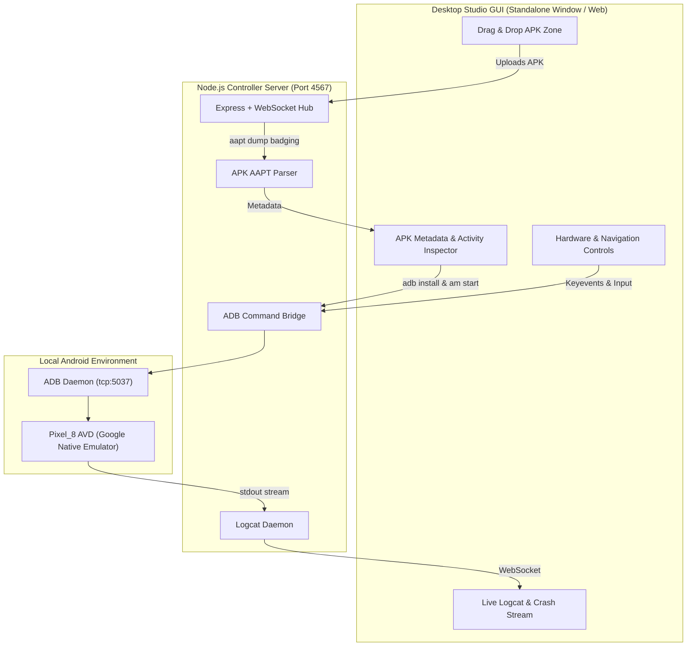

# Android Emulator & APK Test Studio 📱⚡

A modern, high-performance **Desktop Android Emulator Controller & One-Click APK Testing Studio**. Run native Android Virtual Devices (AVDs) or physical devices on your local PC with instant drag-and-drop APK installation, real-time Logcat crash monitoring, and device controls.


---

## ✨ Features

- **🚀 One-Click AVD Launcher**:
  - Automatically discovers installed Android Virtual Devices (such as `Pixel_8`).
  - Boots emulators with hardware acceleration (`-gpu host -no-snapshot-load`).
  - Supports both emulators and real USB-connected physical Android devices.

- **📦 Instant Drag & Drop APK Testing**:
  - Drag any `.apk` file directly onto the studio window.
  - Automatically inspects APK metadata using `aapt` (App Name, Package Name, Version Code/Name, Min SDK, Target SDK, Permissions).
  - One-click **Install & Auto-Launch**: Installs via ADB (`adb install -r -d -t -g`) and immediately starts the main activity.

- **🔥 Real-Time Logcat & Crash Monitor**:
  - Live WebSocket stream of Android system and app logs.
  - **Smart App Filtering**: One click to filter logs exclusively to the active tested package.
  - Instant **Crash Banner Alerts** for `FATAL EXCEPTION`, `NullPointerException`, and ANRs.
  - Search, filter by log level (`VERBOSE`, `DEBUG`, `INFO`, `WARN`, `ERROR`, `FATAL`), and export logs to `.txt`.

- **🎮 Virtual Navigation & Quick Tools**:
  - Hardware buttons: ◀ **Back**, ⏺ **Home**, ▢ **Recents**, ⚡ **Power**, 🔊 **Vol+**, 🔉 **Vol-**.
  - **Quick Text Injection**: Type on your PC keyboard and instantly send text into the focused Android input field.
  - **One-Click Screenshot**: Captures high-res device screenshots and opens them on your desktop.
  - App Lifecycle shortcuts: **Restart App**, **Clear Cache & Data**, **Force Stop**, **Uninstall**.

---

## 🏗️ Architecture



---

## 📋 Prerequisites

1. **Node.js** (v18 or higher) - [Download Node.js](https://nodejs.org/)
2. **Android SDK & Emulator**:
   - Android SDK Command-line Tools / Platform-Tools (`adb.exe`).
   - Android Emulator (`emulator.exe`) with at least one configured AVD (e.g., Pixel 8).
   - *Android Studio provides all of these automatically.*

---

## 🚀 Quick Start (Windows)

### Method 1: One-Click Launcher
Simply double-click:
```bat
start.bat
```
This automatically verifies dependencies, starts the studio, and launches the desktop application window.

### Method 2: Command Line
```bash
# 1. Clone repository
git clone https://github.com/umarfarid97/AndroidEmulator.git
cd AndroidEmulator

# 2. Install dependencies
npm install

# 3. Start Studio
npm start
```
The studio will automatically open as a standalone desktop window (or you can open `http://localhost:4567` in any browser).

---

## 💻 CLI Usage

For automation, CI/CD, or fast command-line workflows, a dedicated CLI is included:

```bash
# List connected devices and available emulators
node src/cli.js status

# Start an emulator
node src/cli.js start Pixel_8

# Inspect any local APK
node src/cli.js inspect path/to/app.apk

# Install and auto-launch on device
node src/cli.js install path/to/app.apk --launch

# Capture a screenshot
node src/cli.js screenshot ./screenshot.png

# Stop the running emulator
node src/cli.js stop
```

---

## 📁 Project Structure

```
AndroidEmulator/
├── bin/
│   ├── start.bat          # Double-click Windows batch launcher
│   └── start.ps1          # PowerShell launcher
├── public/                # Desktop UI assets
│   ├── css/
│   │   └── style.css      # Dark-mode Cyber-Studio styling
│   ├── js/
│   │   └── app.js         # Frontend state, WebSocket logcat & controls
│   └── index.html         # Main dashboard interface
├── src/
│   ├── adb.js             # ADB device, package, and key controller
│   ├── apkParser.js       # Instant AAPT / APK metadata parser
│   ├── cli.js             # Command-line interface
│   ├── config.js          # Auto-detection of Android SDK, ADB, AAPT
│   ├── emulator.js        # AVD lifecycle manager
│   ├── logcatStreamer.js  # Real-time WebSocket Logcat daemon
│   └── server.js          # Express & WebSocket server
├── package.json
└── README.md
```

---

## 📄 License

MIT © [umarfarid97](https://github.com/umarfarid97)
